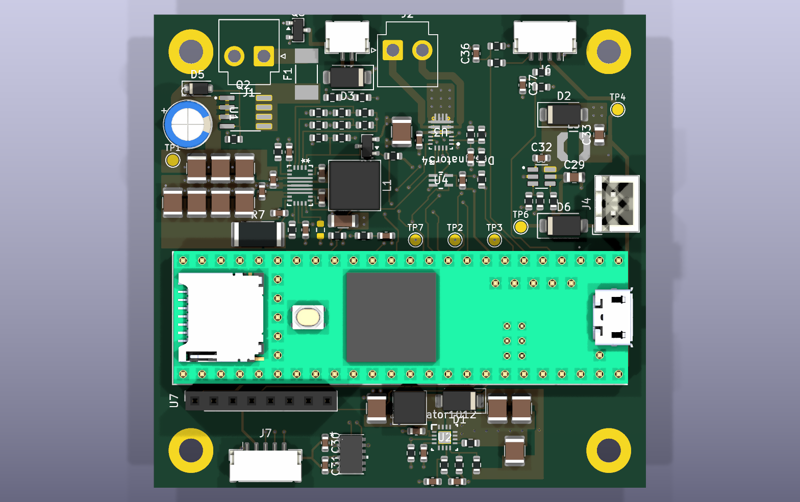

# Reef V3 controller — V4_U1_layout

Parachute reefing controller built around a Teensy 4.1. Four-layer board; every part is on the top side.

## Review files

| File | What it is |
|---|---|
| [plot/Reefing PCB schematic.pdf](plot/Reefing%20PCB%20schematic.pdf) | Full schematic |
| [docs/board_layers.pdf](docs/board_layers.pdf) | One page each: F.Cu, In1.Cu, In2.Cu, B.Cu, F.Silkscreen (with board outline) |
| [docs/board_top.png](docs/board_top.png) | 3D render, top side |
| [plot/](plot/) | Gerbers (`.gbr`, `.gbrjob`) and Excellon drill file (`.drl`) |

## Stackup

| Layer | Use |
|---|---|
| F.Cu | Components, signals, local power pours |
| In1.Cu | Solid GNDA plane |
| In2.Cu | Power: VIN and 12V pours, 24V and 3V3 routing |
| B.Cu | GNDA pour |

## Main parts

| Ref | Part | Function |
|---|---|---|
| U1 | TPS551892-Q1 | 12V buck-boost |
| U2 | TPS55340 | 24V boost |
| U3 | DRV8243-Q1 | Motor driver |
| U6 | LMR16006 | 5V buck |
| U8 / U9 | SN74LVC04 / SN74LVC10 | Interlock logic |
| IC1 | Teensy 4.1 | Controller |

## Net class track widths

| Class | Width |
|---|---|
| Power_4A | 1.5 mm |
| Motor | 1.0 mm |
| Power | 0.5 mm |
| Default | 0.2 mm |

## Fab notes

- Minimum drill is 0.2 mm (TI thermal-via patterns under U2 and U3).
- The U3 VM vias are in-pad and should be filled.
- The Teensy 4.1 footprint has its inner pads removed on purpose. Don't update that footprint from the library.
- DRC is clean as of 2026-11-16.

## Opening the design

1. Clone this repo.
2. Open `V4_U1_layout/Reefing PCB.kicad_pro` in KiCad 10.

The `UL_Parts` footprint library comes from `libs/UL_Parts.pretty` in this repo. All other footprints are stored inside the board file, so it opens and passes DRC without extra libraries.
